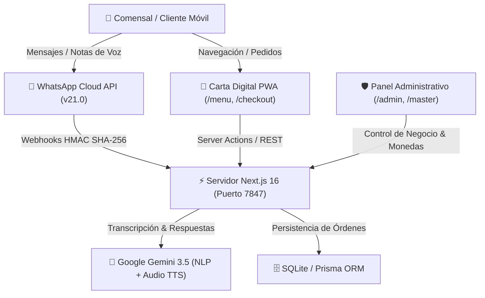

# 🚀 PITHY Chatbot — Enterprise SaaS & WhatsApp Business Platform

<p align="center">
  
</p>

<p align="center">
  <a href="https://nextjs.org"></a>
  <a href="https://react.dev"></a>
  <a href="https://www.typescriptlang.org"></a>
  <a href="https://developers.facebook.com/docs/whatsapp/cloud-api"></a>
  <a href="https://deepmind.google/technologies/gemini/"></a>
  <a href="https://www.prisma.io"></a>
</p>

---

## 🌟 Descripción General

**PITHY Chatbot** es una solución tecnológica empresarial SaaS de alto rendimiento concebida para la **automatización omnicanal de ventas, cartas digitales interactivas y atención al cliente** mediante **WhatsApp Business Cloud API** y una suite web **Progressive Web App (PWA)** instalable.

Desarrollada para restaurantes, locales gastronómicos y comercios de comercio electrónico en **Chile (CLP), Perú (PEN) y Argentina (ARS)**, PITHY integra inteligencia artificial avanzada con procesamiento de lenguaje natural y transcripción en vivo de notas de voz con **Google Gemini**, sincronización en vivo con perfiles de Meta y arquitectura de datos multi-tenant de máxima seguridad.

* **Creador & Autor Intelectual Oficial:** Pierre Arturo Benites Solier (Devlmer)
* **Organización:** Dysa & Devlmer · [https://zgamersa.com](https://zgamersa.com)
* **Servidor en Producción:** [https://chatbot.zgamersa.com](https://chatbot.zgamersa.com)

---

## 🏛️ Arquitectura del Ecosistema



---

## ✨ Módulos y Capacidades Principales

### 1. 📱 Carta Digital PWA Instalable (`/menu`)
- **Instalación Nativa en Android e iOS:** Manifiesto web oficial (`manifest.json`) y Service Worker (`sw.js`) con soporte de caché offline y experiencia de pantalla completa a 60 fps.
- **Catálogo Inteligente por Categoría:**
  - **Bebidas y Complementos:** Botón directo **`+ Agregar`** con agregado en 1 toque al carrito sin pasos innecesarios.
  - **Platos Principales:** Botón **`Personalizar`** que despliega el drawer de personalización según el rubro (hasta 3 cremas tradicionales incluidas, salsas gourmet y promoción *Salchibroaster* exclusiva para pollo broaster).
- **Diseño Limpio:** Eliminación de calificaciones simuladas y eliminación total de accesos administrativos residuales en la vista pública.

### 2. 🛒 Checkout de Alta Precisión & Facturación Multi-País (`/checkout`)
- **Geolocalización Satelital Real:** Botón *"Detectar mi GPS actual"* integrado con **OpenStreetMap Nominatim** para resolver nombre de calle y comuna.
- **Campo Estructurado de Domicilio:** Casillero exclusivo para **N° de Casa / Dpto / Block** que resuelve la imprecisión del satélite móvil.
- **Facturación Electrónica Adaptativa:**
  - **Chile (CLP):** Factura con **RUT** validado (ej: `76.123.456-K`).
  - **Perú (PEN):** Factura con **RUC** de 11 dígitos.
  - **Argentina (ARS):** Factura con **CUIT** de 11 dígitos.
- **Confirmación de Transferencia Simplificada:** Datos bancarios con copiado en 1-clic y confirmación directa mediante captura/voucher adjunto en WhatsApp.

### 3. 🏦 Cuentas Bancarias Adaptativas & Estándar RUT Chileno (`/admin/business`)
- **Auto-formateo Oficial del RUT (`11.111.111-K`):** Algoritmo Módulo 11 en tiempo real con separadores de miles, guión y letra `K` forzada a mayúscula.
- **Sincronización Automática con CuentaRUT:** Banco Estado exige el RUT sin puntos ni dígito verificador como número de cuenta; el sistema lo auto-completa instantáneamente.
- **Soporte Multi-País:** Configuración de cuentas para Perú (BCP, Interbank, Yape/Plin), Chile (Banco Estado, CuentaRUT, Santander) y Argentina (Mercado Pago, Alias CBU/CVU).

### 4. 🤖 Asistente de IA & Bandeja de Entrada Unificada (`/admin/inbox`)
- **Conmutador de Modo:** Switch en vivo entre **[ 🤖 IA Activa ]** y **[ 👤 Asesor Humano ]**.
- **Transcripción de Notas de Voz:** Detección de mensajes de voz entrantes y transcripción automática con insignia visual enriquecida en la bandeja de entrada.
- **Fallback Automático de Modelos:** Resiliencia ante agotamiento de cuotas entre `gemini-3.5-flash` y `gemini-3.5-flash-lite`.

### 5. 👑 Panel Master Multi-Tenant (`/master`)
- Registro de nuevas empresas arrendatarias (*tenants*) con generación de credenciales automáticas.
- Aislamiento estricto de bases de datos y ciclo de vida de procesos PM2.
- Desprovisionamiento seguro con archivado de base de datos `.db.archived_{timestamp}` y purga de registros DNS.

---

## 🔒 Seguridad, Cumplimiento & Directrices (`AGENTS.md`)

* **OWASP ASVS Compliance:** Auditoría de seguridad con validación estricta de precios unitarios en servidor (`POST /api/orders`) para evitar manipulaciones maliciosas.
* **Firma Criptográfica HMAC SHA-256:** Verificación obligatoria de la cabecera `X-Hub-Signature-256` en cada evento entrante de Meta.
* **Control de Puertos Estricto:** Ejecución exclusiva en el **puerto 7847** (bloqueo total del puerto 3000).
* **Cabeceras HTTP de Alta Seguridad:** HSTS Preload (`max-age=63072000`), X-Frame-Options, X-Content-Type-Options y Permissions-Policy (`geolocation=(self)`).
* **Documentación y Memoria en Obsidian:** Registro continuo de decisiones y auditorías en el 2do cerebro en `docs/brain/`.

---

## 🛠️ Stack Tecnológico

| Capa | Tecnologías |
| :--- | :--- |
| **Frontend Web / PWA** | Next.js 16 (App Router), React 19, Tailwind CSS, Lucide Icons |
| **Backend & APIs** | Node.js (TypeScript), Next.js Route Handlers & Server Actions |
| **Base de Datos & ORM** | SQLite, Prisma ORM v6.19 |
| **Inteligencia Artificial** | Google Gemini API (v1beta / v1), Edge-TTS |
| **Infraestructura VPS** | Ubuntu 24.04 LTS, Nginx Reverse Proxy, PM2 Process Manager, Let's Encrypt SSL |
| **Mensajería Oficial** | Meta WhatsApp Business Cloud API (Graph API v21.0) |

---

## 🚀 Instalación y Puesta en Marcha

### 1. Clonar el Repositorio
```bash
git clone https://github.com/Dysa-Devlmer/Chatbot-Devlmer-Prueba.git
cd Chatbot-Devlmer-Prueba
```

### 2. Instalar Dependencias
```bash
npm install
```

### 3. Configurar Variables de Entorno (`.env.local`)
```env
# Puerto Local Obligatorio (Regla Maestra de Seguridad)
PORT=7847
NODE_ENV=development
DATABASE_URL="file:./prisma/dev.db"

# Meta WhatsApp Cloud API Oficial
WHATSAPP_TOKEN="tu_system_user_token"
WHATSAPP_PHONE_NUMBER_ID="tu_phone_number_id_15_digitos"
WHATSAPP_BUSINESS_ACCOUNT_ID="tu_waba_id"
WHATSAPP_WEBHOOK_TOKEN="tu_webhook_verify_token"
WHATSAPP_APP_SECRET="tu_app_secret_de_meta"

# Inteligencia Artificial Google Gemini
GEMINI_API_KEY="tu_google_gemini_api_key"

# Autenticación y Cifrado
NEXTAUTH_SECRET="tu_secreto_criptografico_jwt"
NEXTAUTH_URL="http://localhost:7847"
```

### 4. Base de Datos y Compilación
```bash
# Generar cliente de Prisma y sincronizar esquema
npx prisma generate
npx prisma db push

# Verificación estricta de tipos TypeScript
npx tsc --noEmit

# Servidor de Desarrollo en Puerto 7847
npm run dev -- -p 7847
```

### 5. Despliegue en Producción
```bash
npm run build
pm2 restart chatbot
```

---

## 📜 Políticas Legales y Documentación Normativa

El repositorio incluye toda la documentación legal exigida por Meta Platforms, Inc. y las leyes de comercio electrónico y protección al consumidor de Chile, Perú y Argentina:

* 📄 **[LICENCIA COMERCIAL](file:///E:/prueba/LICENSE):** Licencia de Software Propietario (Pierre Arturo Benites Solier / Devlmer).
* 🔒 **[POLÍTICA DE PRIVACIDAD](file:///E:/prueba/PRIVACY.md):** Tratamiento de datos personales, derechos ARCO y privacidad en WhatsApp. *(Página web: `/privacy`)*.
* 📜 **[TÉRMINOS Y CONDICIONES](file:///E:/prueba/TERMS.md):** Reglas de uso, permisos de geolocalización y compras. *(Página web: `/terms`)*.
* 💸 **[POLÍTICA DE REEMBOLSO](file:///E:/prueba/REFUND.md):** Cancelaciones de comandas, productos perecederos y plazos de devolución. *(Página web: `/refund`)*.
* 🛡️ **[POLÍTICA DE SEGURIDAD](file:///E:/prueba/SECURITY.md):** Estándares OWASP, criptografía y programa de divulgación responsable.

---

## 👤 Autor y Contacto Oficial

**Pierre Arturo Benites Solier (Devlmer)**  
*Desarrollo de Software, Arquitectura Cloud & Soluciones Empresariales*  
- 🌐 Sitio Web: [https://zgamersa.com](https://zgamersa.com)
- 💼 Organización: Dysa & Devlmer
- 📧 Contacto Comercial: `contacto@zgamersa.com`
- 🔒 Contacto de Privacidad: `privacidad@zgamersa.com`
- 🛡️ Reporte de Seguridad: `seguridad@zgamersa.com`

---
*PITHY Chatbot © 2026 Dysa & Devlmer. Todos los derechos reservados.*
