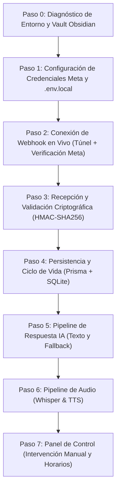

# 🎯 Meta Oficial: Asistente IA WhatsApp Business para Tienda Online (PITHY)

- **Fecha de Inicio:** 2026-11-16
- **Líder de Proyecto:** Pierre (Devlmer)
- **Agente / Asistente:** Antigravity (Google DeepMind)
- **Canal Oficial:** WhatsApp Business Cloud API (Meta)
- **Estado Actual:** 🟡 Fase de Preparación (Paso 0 Completado, Preparando Paso 1)
- **Tags:** `#meta-oficial`, `#whatsapp-business`, `#roadmap`, `#tienda-online`

---

## 📌 Visión del Proyecto
Construir e implementar de forma incremental y testeada un **Asistente Inteligente de WhatsApp Business para la Tienda Online**, conectado al número oficial de empresa de Pierre.

El bot atenderá a clientes 24/7 con:
1. Respuestas automáticas precisas a través de IA multi-proveedor (Perplexity / Claude / Ollama).
2. Procesamiento de voz (transcripción de notas de voz del cliente vía Whisper y respuestas en audio vía TTS).
3. Respeto de horarios comerciales y cambio dinámico a atención humana (modo manual) desde el panel de control.
4. Registro histórico de conversaciones en SQLite con Prisma y auditoría de eventos.

---

## 🚦 Principio de Desarrollo: "Test Before Next"
> Cada paso debe ser **desarrollado, probado y comprobado formalmente al 100%** antes de poder continuar con el siguiente paso. Si una prueba falla, el avance se detiene hasta solucionar la causa raíz.

---

## 🗺️ Roadmap Paso a Paso

### Paso 0: Diagnóstico de Entorno y Creación de Segundo Cerebro
- [x] Ejecutar `npm test` (50/50 tests unitarios pasados).
- [x] Ejecutar `npm run build` (39 rutas compiladas exitosamente).
- [x] Probar servidor en puerto 7847 con endpoint `/api/health`.
- [x] Crear Vault de Obsidian en `E:\prueba` y registrarlo en `obsidian.json`.
- [x] Crear nota de Meta Oficial y estructura del cerebro.

---

### Paso 1: Configuración Segura de Credenciales Meta y Entorno
- **Estado:** ✅ COMPLETADO Y VERIFICADO (2026-11-16)
- **Objetivo:** Definir y cargar en `E:\prueba\.env.local` todas las variables requeridas para la API de Meta.
- **Variables configuradas y validadas:**
  - `WHATSAPP_TOKEN`: Token permanente de System User (`Dysa Bot`) ✅
  - `WHATSAPP_PHONE_NUMBER_ID`: `905984725929536` (+56 9 6541 9765) ✅
  - `WHATSAPP_BUSINESS_ACCOUNT_ID`: `779998311756531` (Devlmer Apps) ✅
  - `WHATSAPP_APP_SECRET` & `WHATSAPP_WEBHOOK_SECRET`: `42b6ca...` ✅
  - `WHATSAPP_WEBHOOK_TOKEN`: `mi_token_secreto_123` ✅
- **Comprobación Realizada:**
  - Petición HTTPS directa a `https://graph.facebook.com/v21.0/`
  - HTTP 200: Permisos `whatsapp_business_messaging`, `whatsapp_business_management`, `whatsapp_business_manage_events` activos y verificados.

---

### Paso 2: Conexión del Webhook en Vivo con Meta
- **Objetivo:** Exponer el servidor local a través de Cloudflare Tunnel / túnel seguro y verificar el webhook desde el panel de Meta for Developers.
- **Método de Prueba y Comprobación:**
  - Envío de desafío de verificación (`hub.challenge`) desde Meta a `/api/whatsapp/webhook`.
  - Comprobar que el endpoint responde `HTTP 200` devolviendo el desafío exacto.
  - El panel de Meta muestra "Webhook verificado con éxito" (check verde).

---

### Paso 3: Recepción y Validación Criptográfica de Mensajes Reales
- **Objetivo:** Recibir un mensaje de prueba real enviado desde un WhatsApp al número de la tienda y comprobar la firma digital `X-Hub-Signature-256`.
- **Método de Prueba y Comprobación:**
  - Enviar "Hola bot" desde un teléfono personal al número de la tienda.
  - Verificar en los logs estructurados de Winston (`logs/whatsapp.log`):
    - `HMAC validation successful`
    - Payload parseado correctamente sin errores.
    - Se rechazan peticiones con firmas falsificadas.

---

### Paso 4: Capa de Persistencia y Gestión de Conversaciones
- **Objetivo:** Asegurar que cada mensaje entrante cree o actualice al usuario en la base de datos SQLite y cree una conversación activa con su mensaje correspondiente.
- **Método de Prueba y Comprobación:**
  - Comprobación en base de datos vía Prisma de:
    - Usuario creado con su `phoneNumber` y `name`.
    - Conversación vinculada en estado `active`.
    - Mensaje guardado con dirección `inbound`.
  - Corregir y ejecutar la suite de pruebas E2E en `.e2e-tests`.

---

### Paso 5: Generación y Envío de Respuestas con IA
- **Objetivo:** Procesar el mensaje del cliente con el motor de IA (Perplexity -> Claude -> Ollama) y enviar la respuesta de texto de vuelta al WhatsApp del cliente vía Meta Graph API.
- **Método de Prueba y Comprobación:**
  - El cliente recibe en su WhatsApp real la respuesta inteligente generada en menos de 3 segundos.
  - Se registra el mensaje saliente (`outbound`) en la base de datos.
  - Prueba de simulación de fallo del proveedor principal para verificar que el fallback responde sin interrupciones.

---

### Paso 6: Procesamiento de Voz Bidireccional (Whisper + TTS)
- **Objetivo:** Transcribir mensajes de audio recibidos y, si está configurado, responder con notas de voz sintetizadas.
- **Método de Prueba y Comprobación:**
  - Enviar una nota de voz al número de WhatsApp.
  - Descarga y transcripción con Whisper.
  - Generación de audio OGG/Opus y entrega exitosa al usuario.

---

### Paso 7: Panel de Control e Intervención Humana (Modo Manual)
- **Objetivo:** Probar el cambio a atención humana en tiempo real desde `http://localhost:7847/admin`.
- **Método de Prueba y Comprobación:**
  - Activar "Modo Manual" para la conversación de prueba.
  - Enviar un mensaje desde WhatsApp; comprobar que el bot NO responde automáticamente.
  - Escribir una respuesta desde el panel de administración y verificar que llega al WhatsApp del usuario.
