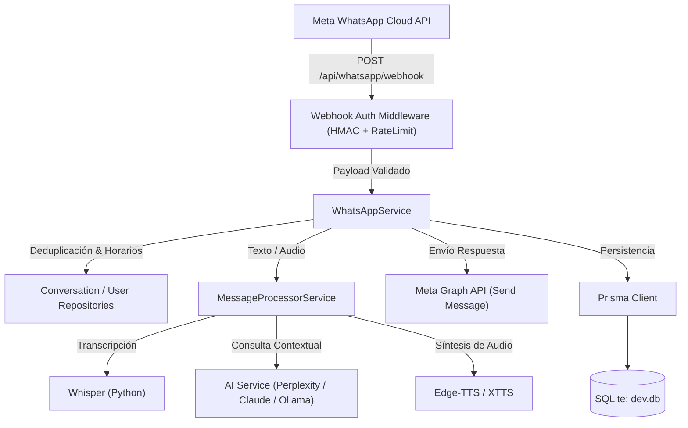

# 🏗️ Stack y Arquitectura del Sistema

- **Fecha:** 2026-11-16
- **Tags:** `#architecture`, `#stack`, `#security`, `#layers`

---

## 🏛️ Diagrama de Flujo en Capas

---

## 📦 Componentes Principales

| Capa | Archivos Clave | Responsabilidad |
| :--- | :--- | :--- |
| **API Routes** | `app/api/whatsapp/webhook/route.ts` | Endpoint público para Meta (GET challenge / POST eventos) |
| **Middleware** | `src/middleware/webhook-auth.ts`, `src/middleware/rateLimit.ts` | Validación criptográfica HMAC-SHA256 y protección contra abusos |
| **Servicios** | `src/services/WhatsAppService.ts`, `src/services/MessageProcessorService.ts` | Orquestación del ciclo de vida del mensaje y llamada a IA |
| **Repositorios** | `src/repositories/` (User, Conversation, Message, WebhookLog) | Acceso desacoplado a datos |
| **Persistencia** | `prisma/schema.prisma` | Modelado de datos en SQLite |
| **Panel Admin** | `app/admin/` | Interfaz React 19 para supervisión y control manual |
